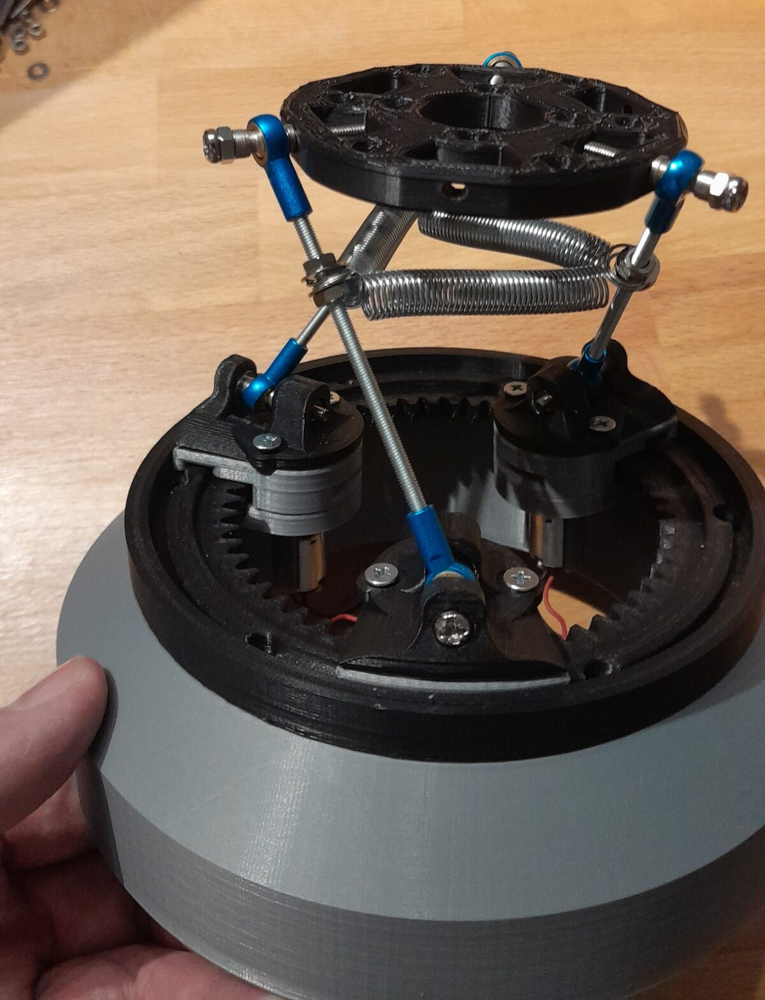
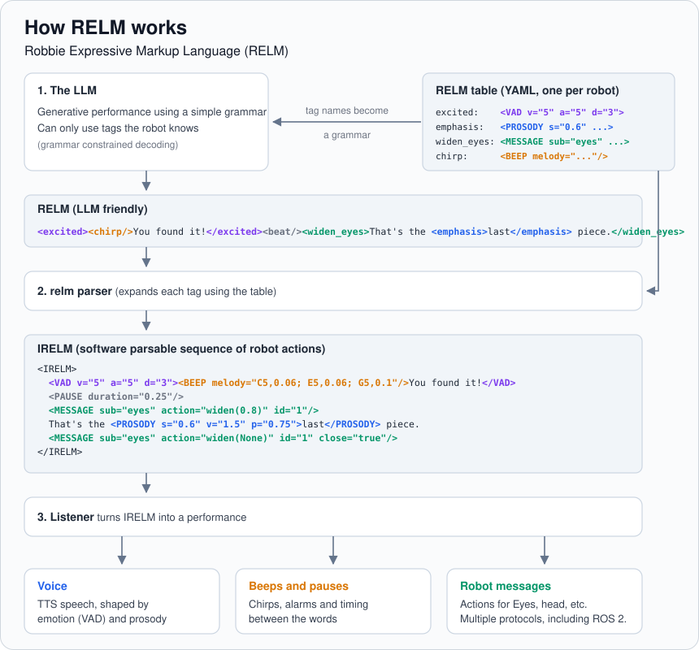

# robbie

Open Source Agentic Robot.

This project is teh main repo for Robbie.  
The other related projects:
  - 3D printable parts and assembly (https://github.com/busyDuckman/robbie_openscad)
  - Look around behaviour (https://github.com/busyDuckman/look_around)
  - Robot control, ROS 2 (https://github.com/busyDuckman/robbie_ros)

Legacy:
  - Eye graphics rendering, other bits and pieces (https://github.com/busyDuckman/robbie_restoration)
  - You may see references to assorted other projects that were not open sourced. Those are being replaced as part of this project.

The goal is to achieve a low cost agentic robot for interaction in group situations (stores, social events, meetings) and have it available under the MIT licence (the last part not easy).

New work:
  - **Robbie's personality and agentic framework** is old (started when transformers were a novel thing) and predates modern established practices. This project will modernise that framework.

  - **Inverse-Kinematics and controller re-write.**  The previous system used the camera to establish the system pose. That may sound ill-advised, but was something I wanted to try, just to push and see what was possible (it's my hobby project so I indulged my curiosity). That was abandoned, the new system puts a magnetic rotary sensor on each motor.
    See [robbie_ros](https://github.com/busyDuckman/robbie_ros).

  
  

# Status

TRL 3, "experimental proof of concept".

# Getting started

Development is done on Linux, or on Windows inside WSL 2. Docker is required; by default the containers run on the local machine.

Everything is driven from the justfile. Run `just` to list the recipes. The main ones are:

    just setup    # get the repo ready for development 
                  # downloads AI models, creates .env files etc
    just test     # unit tests
    just vet      # full testing, including model evals
    just chat     # chat with Robbie's LLM in the terminal
    just up       # start the local services (just down to stop them)

# Architecture

Robbie is composed of 3 layers.

  - A) The LLM: Decides when to speak, or take an action.
  - B) The harness: State, behaviour, people present, attention target, mood, relationships, beeps, TTS. Manages the mic and camera. This layer is a collection of software components written in different languages.
  - C) Robot Control: Drive motors, read sensors (encoders, home switches). ROS 2 based. Look-around, eye graphics.

This repo only covers layers A and B. Layer C is in a separate repo (https://github.com/busyDuckman/robbie_ros).

# Stand ins

This repo can run without robbie or a pi. There is a stand in for layer C and layer B can be configured to run from any machine with a microphone, webcam and speakers.

# Repo Structure

Folder layout (some folders are placeholders for planned work)

    robbie/
      .github/workflows/    CI (disabled at first)
      .plans/               planning scratch space (copy to docs when concrete)
      .models/              If a model is not found elsewhere, and we need a local copy.
      docs/                 design docs

      config/
        relm_table.yaml       Robbie's RELM table
        robbie_agent/         Layer A config (.env.example)
        robbie_services/      Layer B config
        tools/                tech stack config etc

      prompts/
        robbie_persona/             persona prompt files, versioned by git
        ethics/
        activity_bootstrap/

      training/

      data/                   Things that robbie can access (just fetch-data to bootstrap)
        reference_material/   Information kept by robbie, for definitive reference and RAG
          social/
            cocktail_recipes/   Social events companion
            boardgame_rules/    Games night or D&D companion.
            jokes/              Quick one liners etc
          business/
            negotiation/        Value propositions etc
            product_info/       Information about products robbie is discussing
          robbie/               Information about robbie, even some pictures of robbie for self recognition.
        images/
        audio/

      common/               Common Robbie Code that any service can use
        interfaces/
          RELM/               Robbie's Expressive Language Model (what the llm outputs)
          proto/              Protobuf schemas for messages inside B (buf config here)
          ros/                (the message definitions only) ROS 2 message package for the B to C interface
        robbie-lib-py
          emotion/          So services getting an emotion state as messages, use unified emotion code (ie: AVD -> isHappy())
          relm/
        robbie-lib-rs       (synced agentic port of robbie-lib-py)
          emotion/
          relm/
        robbie-lib-test     Shared test data (so agentic porting is proven correct)

      agent/                (layer a) one folder per container, any language
        llm/                Layer A: agent loop and llama.cpp client
        search/             LangChain to /data

      services/             (layer b) one folder per container, any language
        core/               state, mood, relationships, scheduler, policy gate
        hearing/            mic, voice activity, speech recognition, who said what
        vision/             camera, face detection and identity
        voice/              TTS (MaryTTS) and beeps
        listener/           speaks RELM through the voice service
        memory/             memory store, redaction, audit log  (separate to /data)
        mcp/                MCP servers
        ros_bridge/         the single ROS 2 node that talks to Layer C

      deploy/
        compose.local.yaml          everything on one machine
        compose.observability.yaml  Phoenix tracing
        compose.backend.yaml        backend services (planned)
        compose.pi.yaml             services on the robot's Pi (planned)

      scripts/
        setup/              used by just setup
        tests/              used by just vet

      testing/
        integration_tests/  (just test)
        layer_c_robot/      a fake Layer C for demo/humans, (Rerun + web view of robbie) using Python look_around
        layer_c_text/       a super simple fake Layer C, for dev/ai, that outputs events to stdout/stderr
        evals/              Inspect AI suites, ethics scenarios, synthetic data (just vet)
        service_proforma    What a service container should look like, and testing to check it starts/stops etc.

# Services

Services all provide a justfile

Dockerfile will have

    ENTRYPOINT ["just"]
    CMD ["serve"]

Justfile will have

    default: serve
    setup:    # For those rare times when actions genuinely need to be taken after docker creates the container.
    test:     # run unit tests
    serve:    # run the service
    vet:      # run CI tests

# The RELM System

## The problem
An LLM can write what a robot should say, and MCP style tool calls let it take actions. Neither covers how the robot should say it (the performance): the tone of voice, the pause before the punchline, the eyes widening on the right word. Speech markups like SSML and EmotionML only cover the voice, are tied to particular TTS engines, and are verbose for an LLM to write.

## Introducing RELM
RELM (Robbie Expressive Markup Language). The LLM writes the script and the performance together, in short named tags inline with the words, so expression lands at the right moment in the sentence:

    <happy>Welcome back!</happy><beat/><curious><tilt_head>How did the interview go?</tilt_head></curious>

    <excited><chirp/>You found it!</excited> That's the <emphasis>last</emphasis> piece of the puzzle.

    <calm>The next session starts at <time>14:30</time>.</calm>

    <pleasant>I'll let you know when it's time to head in.<nod/></pleasant>

    <whisper>The surprise party is in the next room.</whisper><wink/>

The LLM only sees the tag names. A table maps each one to voice, emotion and body actions for a given robot, so the same LLM output can drive a different robot or TTS engines by changing the table, not the prompt. While the grammar constrained decoding means the LLM can only produce tags the robot knows.

# What works now

**RELM, Robbie's Expressive Language Model** (see [docs/relm.md](docs/relm.md)). The LLM "scripts" Robbie's dialogue and expression with named tags, for example:

    <happy> She asked me to buy <widen_eyes><emphasis>roses</emphasis></widen_eyes></happy>

A YAML table ([config/relm_table.yaml](config/relm_table.yaml)) expands those tags into IRELM, a structured markup of emotion (VAD), prosody, pauses and messages to robot parts such as the eyes. A listener then turns IRELM into speech and actions. RELM is implemented in Python (common/robbie-lib-py) with a Rust port (common/robbie-lib-rs), both checked against the same shared test cases (common/robbie-lib-test).

**Chat with Robbie.** `just chat` starts a local LLM (llama.cpp in Docker, on the GPU) with Robbie's persona prompt, and chats in the terminal. Replies are constrained by a grammar generated from the RELM table, so the LLM can only use tags Robbie knows. In the chat, `/irelm` shows what each reply expands to.

**Robbie speaks.** `just up` starts the local services: MaryTTS for the voice, the RELM listener (Rust) and Phoenix for tracing. Then:

    just say "Hello there"                                  # plain speech
    just relm "<happy>hello <emphasis>there</emphasis></happy>"   # expressive speech from RELM

Until the messaging layer exists, messages meant for other parts of the robot (eyes etc) are written to the listener's log.
